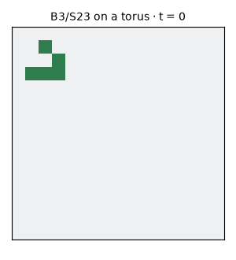
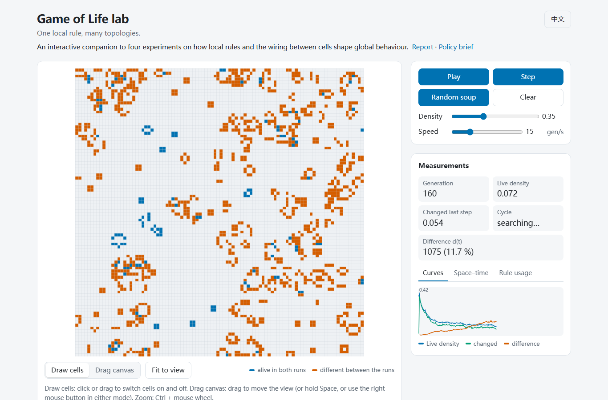

# Conway's Game of Life — from simulator to experiments

[](https://github.com/FreeyaFly/conway-game-of-life/actions/workflows/ci.yml)

> **Status:** v2.0. Four experiments, a report, a policy brief and an [interactive web version](https://freeyafly.github.io/conway-game-of-life/).
>
> **Read:** [Report](docs/report.md) ([中文](docs/report.zh.md)) · [Policy brief](docs/policy-brief.md) ([中文](docs/policy-brief.zh.md))

How do **local rules** and the **interaction topology** together determine **global behaviour**?

This project started as a Tkinter simulator of Conway's Game of Life (v1, 2023). v2 rebuilds it as a small computational-experiment platform. One engine runs both square lattices and arbitrary networks, and four experiments probe attractors, topology, criticality, and rule space.

<p align="center"></p>

## Try it in the browser

**[https://freeyafly.github.io/conway-game-of-life/](https://freeyafly.github.io/conway-game-of-life/)**: change the rule and the topology, watch live measurements, and run twins that differ by one cell. No installation needed.

[](https://freeyafly.github.io/conway-game-of-life/)

Links that open a specific experiment:

- [Life on a network with 30 % of links rewired: it never settles](https://freeyafly.github.io/conway-game-of-life/?topology=rewired&beta=0.3&w=64&h=64)
- [One flipped cell under Life (twin run)](https://freeyafly.github.io/conway-game-of-life/?twin=1)
- [The Replicator rule on a 32 × 32 torus: empty at generation 16](https://freeyafly.github.io/conway-game-of-life/?rule=B1357/S1357&w=32&h=32&paused=1)
- [How often Life uses each entry of its rule table](https://freeyafly.github.io/conway-game-of-life/?steps=300&tab=usage)

## Growth line

| Version | What it is |
|---|---|
| [v1](v1/) | Single-file Tkinter simulator (March 2023), tagged `v1.0` |
| v2 | Vectorised engine + tests + four documented experiments + report and policy brief + a web version |

## The engine in one line

```
next = f(state, A · state)
```

`A · state` is the number of live neighbours of every cell, and `f` is a life-like rule such as `B3/S23`. On a square lattice, `A · state` is computed by convolution; on any other network, by a sparse matrix product. A lattice is just one particular `A`, and the tests check that both paths agree cell by cell (see [ADR 0001](docs/adr/0001-unified-engine.md)).

```python
from life.engine import run
from life.patterns import GLIDER, place
from life.rules import parse_rule
from life.topology import Graph, Lattice, lattice_adjacency

state = place(GLIDER, (16, 16), at=(1, 1))
history = run(state, 64, parse_rule("B3/S23"), Lattice("torus"))  # shape (65, 16, 16)

# The same lattice, run as a network:
same = run(state, 64, parse_rule("B3/S23"), Graph(lattice_adjacency((16, 16), "torus")))
```

## Getting started

Requires Python 3.11.

```
python -m venv .venv
.venv/bin/python -m pip install -e ".[dev]"        # Windows: .venv\Scripts\python.exe
.venv/bin/python -m pytest -q
.venv/bin/python scripts/make_glider_gif.py         # writes docs/figures/glider.gif
node --test "tests/js/*.test.mjs"                   # tests the browser engine (Node 18+)
python -m http.server 8790 --directory web          # then open http://localhost:8790
```

## Layout

```
life/        engine.py, rules.py, topology.py, patterns.py, metrics.py, networks.py,
             avalanches.py, stats.py, rulespace.py
notebooks/   one notebook per experiment
data/        raw results behind the figures
web/         the browser version: engine.js, app.js, index.html (no build step)
tests/       pytest suite; js/ for the browser engine; fixtures/ shared by both
scripts/     figure generation
docs/        experiment write-ups, methods, concepts, puzzles, decisions (adr/), figures
v1/          the original 2023 simulator, unchanged
```

## Progress

| Stage | What | Status | Details |
|---|---|---|---|
| 0 | **Foundations**: engine, tests, CI | ✅ done | [checklist](docs/stage0-checklist.md) · [#1](https://github.com/FreeyaFly/conway-game-of-life/issues/1) |
| 1 | **Attractors and chaos**: transient length, cycle period, damage spreading from a one-cell flip | ✅ done (`v2.0-alpha.1`) | [checklist](docs/stage1-checklist.md) · [write-up](docs/experiments/01-attractors.md) · [#2](https://github.com/FreeyaFly/conway-game-of-life/issues/2) |
| 2 | **Topology rewiring**: lattice → small world → random graph. Life switches from freezing to boiling when about 20 % of edges are rewired | ✅ done (`v2.0-alpha.2`) | [checklist](docs/stage2-checklist.md) · [write-up](docs/experiments/03-topology.md) · [#3](https://github.com/FreeyaFly/conway-game-of-life/issues/3) |
| 3 | **Phase transition and criticality**: initial-density sweep and avalanches. Extinction is a finite-size effect; avalanches have a heavy tail but are probably not critical | ✅ done (`v2.0-alpha.3`) | [checklist](docs/stage3-checklist.md) · [write-up](docs/experiments/02-criticality.md) · [#4](https://github.com/FreeyaFly/conway-game-of-life/issues/4) |
| 4 | **Systems view**: causal loop diagrams and a scan of life-like rule space. Two thirds of rules are chaotic, about 3 % complex like Life | ✅ done (`v2.0-alpha.4`) | [checklist](docs/stage4-checklist.md) · [write-up](docs/experiments/04-systems.md) · [#5](https://github.com/FreeyaFly/conway-game-of-life/issues/5) |
| 5 | **Report** tying the experiments together, and a policy brief, in English and Chinese | ✅ done (`v2.0-alpha.5`) | [checklist](docs/stage5-checklist.md) · [report](docs/report.md) · [brief](docs/policy-brief.md) · [#6](https://github.com/FreeyaFly/conway-game-of-life/issues/6) |
| 6 | **Web version** on GitHub Pages: rules, topologies, live measurements, twin runs | ✅ done (`v2.0`) | [checklist](docs/stage6-checklist.md) · [open](https://freeyafly.github.io/conway-game-of-life/) · [#7](https://github.com/FreeyaFly/conway-game-of-life/issues/7) | [#7](https://github.com/FreeyaFly/conway-game-of-life/issues/7) |

Puzzles the data turned up along the way are collected in [docs/puzzles.md](docs/puzzles.md).

## License

[MIT](LICENSE)
