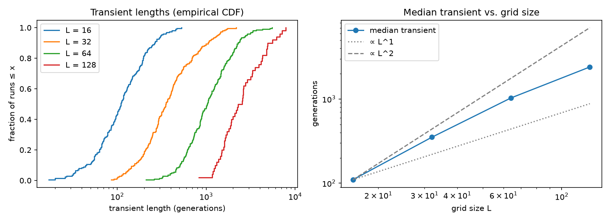
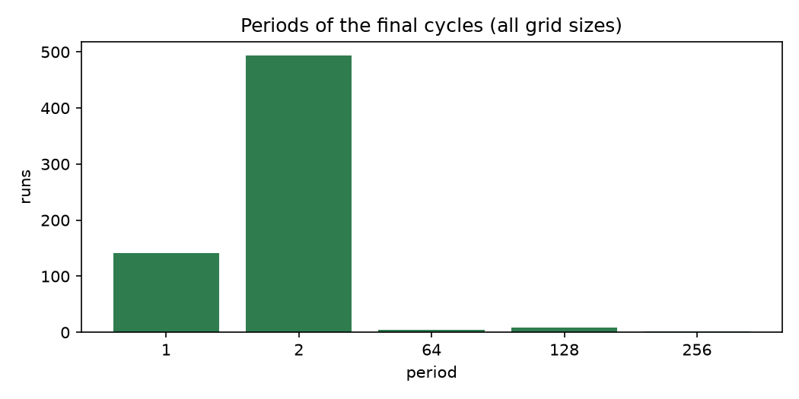

# Experiment 1: attractors and chaos

> **Status:** parts 1a and 1b done; part 1c (damage spreading) in progress.
> Notebook: [`notebooks/01_attractors.ipynb`](../../notebooks/01_attractors.ipynb) · raw data: [`data/exp01/cycles.csv`](../../data/exp01/cycles.csv)

## Question

A finite grid with a deterministic rule must eventually repeat a state, so every run ends on a cycle (an *attractor*). Starting from random soups on a torus:

1. How long does Conway's Game of Life wander before reaching its cycle (the *transient*), and how does that depend on the grid size $L$?
2. What kind of cycle does it end on (the *period*)?
3. How sensitive is the outcome to flipping a single initial cell? *(part 1c)*

## Predictions (written before any run)

| # | Question | Prediction |
|---|---|---|
| 1 | Typical transient on a 64 × 64 torus, density 0.35 | ~10 000 generations |
| 2 | Transient when $L$ doubles from 64 to 128 | grows like $L^2$ |
| 3 | Most common period; very long periods? | around 100; very long periods are rare |
| 4 | Fraction of single-cell flips that end on the same attractor | ~1 in 1000 |
| 5 | Growth of the damage $d(t)$ under Life | grows, then levels off (S-shaped) |
| 6 | Any run not settling within 20 000 generations? | none |

## Method

- Torus, Moore neighbourhood, rule B3/S23. Initial cells alive independently with probability 0.35; seeds 0, 1, 2, … for reproducibility.
- Grid sizes $L$ = 16, 32, 64 (200 soups each) and 128 (50 soups).
- `detect_cycle` stores every state as packed bytes and stops at the first repeat, so transient and period are exact. The cap is 20 000 generations; a run hitting it would be reported as censored.

## Results

### 1a. Transients

| $L$ | runs | censored | median | mean | 90th pct. | max |
|---|---|---|---|---|---|---|
| 16 | 200 | 0 | 110 | 136 | 262 | 528 |
| 32 | 200 | 0 | 352 | 479 | 1048 | 2175 |
| 64 | 200 | 0 | 1029 | 1266 | 2272 | 5481 |
| 128 | 50 | 0 | 2404 | 2892 | 4984 | 7824 |

The median transient grows faster than $L$ but slower than $L^2$, and the growth slows down as $L$ increases (×3.2, ×2.9, ×2.3 per doubling).

### 1b. Periods

| period | 1 | 2 | 64 | 128 | 256 |
|---|---|---|---|---|---|
| runs (all sizes) | 141 | 494 | 5 | 8 | 2 |

By grid size: $L$ = 16 → 112 × period 1, 83 × period 2, 5 × period 64; $L$ = 32 → 28, 164, 8 × period 128; $L$ = 64 → 1, 197, 2 × period 256; $L$ = 128 → 50 × period 2.

### Predictions vs. results (1a, 1b)

| # | Prediction | Result |
|---|---|---|
| 1 | ~10 000 | Median 1029: off by a factor of ten. Most regions turn into still lifes and blinkers within a few hundred generations. |
| 2 | $\propto L^2$ | Between $L$ and $L^2$, with a falling slope; see puzzle C for why. |
| 3 | period ~100, long periods rare | Period 2 dominates (76 %) because the grid's period is the least common multiple of its objects' periods (puzzle B). Long periods are indeed rare (2.3 %) and come from gliders (puzzle A). |
| 6 | none censored | Correct: all 650 runs settled; the longest transient was 7824. |

## Puzzles

**A. Long periods are exactly 64, 128 and 256, and each appears on only one grid size ($L$ = 16, 32, 64).**
*Hint: how many generations does a glider need to cross an $L \times L$ torus?*

Answer

All three equal $4L$. A glider moves one cell diagonally every 4 generations, so on an $L \times L$ torus it is back where it started after $4L$ generations. If a glider survives the transient, it circles forever and the whole grid has period $4L$. Replaying one of the period-64 runs on $L$ = 16 shows exactly that: its final cycle contains a single glider (5 live cells, 8 cells changing every 4 generations). On an infinite plane the glider would simply fly away, so these long periods are an artefact of the torus.

**B. The bigger the grid, the rarer period 1; on 128 × 128 every soup ends with period 2.**
*Hint: the grid's period depends on the period of every object on it.*

Answer

The period of the whole grid is the least common multiple of the periods of all objects on it. A single blinker (period 2) makes the whole grid period 2; period 1 requires that not one oscillator is left. A larger grid holds more objects, so "no oscillator at all" becomes very unlikely. A simple Poisson model fitted on $L$ = 16 (where 56 % of runs end with period 1) predicts 10 % for $L$ = 32 (observed 14 %) and essentially 0 for $L$ = 64 and 128 (observed 0.5 % and 0 %): the right trend, slightly underestimating the tail.

**C. Big grids never settle quickly: on 128 × 128 the shortest transient is 827 generations.**
*Hint: the grid is settled only when every region has settled.*

Answer

The transient of the whole grid is roughly the **maximum** of the transients of its regions. A 128 × 128 torus has the area of four 64 × 64 ones, so its transient behaves like the slowest of four. Drawing four transients from the $L$ = 64 results and taking the maximum (100 000 times) gives a median of 2042 and a 1st percentile of 764, against an observed median of 2404 and minimum of 827. The model explains most of the effect; the rest plausibly comes from interactions between regions (gliders and debris carrying activity elsewhere). Because a maximum grows slowly with the number of regions, it also explains why the transient grows more slowly than $L^2$.

**D. Period 3 never appears, although period-3 oscillators (such as the pulsar) exist.**
*Hint: what would the grid's period be with one pulsar and one blinker on it?*

Answer

A pulsar would make the grid's period 3, or 6 together with any blinker. Neither value appears, so none of the 650 final states (about 13 000 separate clusters of live cells in total) contains a period-3 oscillator. The pulsar has 48 cells and a high symmetry, and random soups rarely build it.

**E (open). No period 512 on the 128 × 128 torus.**

Current thinking

Not known. A glider survived in 2.5 %, 4 % and 1 % of the runs on $L$ = 16, 32 and 64. With a rate of 1–4 %, 50 runs would be expected to show 0.5–2 gliders; at 2 %, seeing none has a probability of about 36 %. So the absence may be chance. More runs on $L$ = 128, or a direct measurement of how often gliders are destroyed by debris on large grids, would settle it.

## Limitations

- Only one initial density (0.35) and one rule for parts 1a and 1b.
- 50 runs at $L$ = 128 make the large-grid numbers less precise.
- The torus lets gliders circle forever; on an open or infinite grid the long periods would not exist.

## Open questions

- How exactly does the transient scale with $L$ for larger grids, and how much of it is "slowest region" versus long-range interaction?
- Puzzle E: are gliders rarer survivors on large grids, or was it chance?
