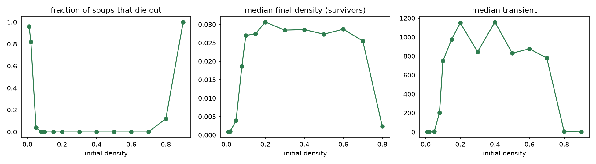
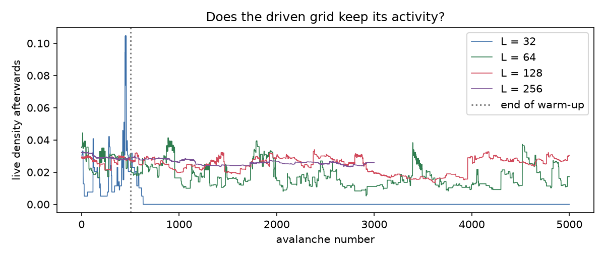

# Experiment 2: phase transition and criticality

> **Status:** done (v2.0-alpha.3).
> Notebook: [`notebooks/02_criticality.ipynb`](../../notebooks/02_criticality.ipynb) · raw data: [`data/exp02/`](../../data/exp02/)

## Question

Experiment 3 showed a phase transition driven by the topology. This experiment returns to the square lattice and turns two other dials:

1. **Initial density (2a).** Does the outcome of a random soup change abruptly at some starting density? Is there an extinction threshold, as on the random network (0.19)?
2. **Avalanches (2b, 2c).** Let the grid settle, add one live cell, wait until it settles again, and measure how far the disturbance spread. Bak, Chen and Creutz (1989) reported that these avalanches follow a power law, which would make Life *self-organized critical* (SOC) like the sandpile model of Bak, Tang and Wiesenfeld (1987).

## Predictions (written before any run)

| # | Question | Prediction |
|---|---|---|
| 1 | Final density for starting densities 0.2–0.6 | roughly constant |
| 2 | Below which starting density do most soups die out? Lower or higher than 0.19? | lower, about 0.1 |
| 3 | What happens at starting densities 0.8 and 0.9? | a still state |
| 4 | Starting density with the longest transients | 0.1 |
| 5 | Avalanche sizes on log–log axes: straight line or bending down? | straight line |
| 6 | Slope, roughly | −1 |
| 7 | From $L$ = 32 to 128, does the largest avalanche keep growing or level off? | levels off |
| 8 | Is Life self-organized critical? | yes |

## Method

- **2a:** 64 × 64 torus, 14 starting densities from 0.01 to 0.9, 50 soups each, followed to their cycle. A second check runs sparse densities (0.01–0.03) on grids from 32 to 256, 40 soups each, and counts those still alive after 200 generations.
- **2b:** open boundaries: the outer two rows and columns are cleared after every step, so gliders can leave ([ADR 0003](../adr/0003-avalanche-definition.md)). Grids of side 32, 64, 128 (5000 avalanches each) and 256 (3000). Each avalanche adds one live cell at a random dead interior site of a settled grid; its **size** is the number of cells that ever differ from the undisturbed run, its **duration** the number of generations until the grid is back on a cycle. The first 500 avalanches are warm-up; avalanches after a grid has run empty are excluded.
- **Fits:** discrete power law by maximum likelihood with the lower cut-off chosen by the KS distance, compared with an exponential tail by a likelihood-ratio test (Clauset, Shalizi & Newman 2009); see [methods](../methods.md).
- **2c:** the same avalanches on a 64 × 64 torus (2000), where gliders cannot leave.

## Results

### 2a. Initial density

| start density | 0.01 | 0.02 | 0.05 | 0.08 | 0.1 | 0.2 | 0.4 | 0.6 | 0.7 | 0.8 | 0.9 |
|---|---|---|---|---|---|---|---|---|---|---|---|
| died out (of 50) | 48 | 41 | 2 | 0 | 0 | 0 | 0 | 0 | 0 | 6 | 50 |
| median final density of survivors | 0.001 | 0.001 | 0.004 | 0.019 | 0.027 | 0.031 | 0.029 | 0.029 | 0.026 | 0.002 | — |
| median transient | 1 | 2 | 5 | 204 | 750 | 1150 | 1159 | 877 | 779 | 5 | 2 |

Between about 0.1 and 0.7 the outcome barely depends on where the soup started: about 3 % of cells remain alive after roughly 1000 generations. Below about 0.05 and above 0.8 the soups die out or nearly so.

**Fraction still alive after 200 generations:**

| $L$ | start 0.01 | 0.02 | 0.03 |
|---|---|---|---|
| 32 | 5 % | 5 % | 20 % |
| 64 | 0 % | 18 % | 65 % |
| 128 | 15 % | 68 % | 98 % |
| 256 | 20 % | 100 % | 100 % |

The lower the density at which a grid survives, the larger the grid: there is no fixed extinction threshold.

### 2b. Avalanches

The 32 × 32 grid ran empty after 631 avalanches and stayed empty; only 131 usable avalanches remain, too few to fit. The larger grids kept a live density of roughly 1–3 %.

| $L$ | usable avalanches | median size | 99th percentile | largest | size $\alpha$ (tail $n$) | power law vs. exponential |
|---|---|---|---|---|---|---|
| 64 | 4500 | 1 | 594 | 3355 | 2.48 ± 0.20 (53) | undecided ($p$ = 0.95) |
| 128 | 4500 | 1 | 1578 | 10 192 | 1.59 ± 0.04 (266) | power law ($p$ < 0.001) |
| 256 | 2500 | 1 | 1857 | 30 189 | 1.81 ± 0.11 (55) | power law, not significant ($p$ = 0.10) |

Durations: $\alpha$ = 1.42 ± 0.02 at $L$ = 128 (power law favoured, $p$ < 0.001); 1.91 ± 0.12 at 256 (not significant).

### 2c. Torus control

On the 64 × 64 torus: size $\alpha$ = 1.56 ± 0.06 (tail of 89, power law favoured, $p$ = 0.003), duration $\alpha$ = 1.43 ± 0.03; the largest avalanche covered all 4096 cells and lasted 4418 generations.

### Predictions vs. results

| # | Prediction | Result |
|---|---|---|
| 1 | final density roughly constant for 0.2–0.6 | **Correct**: 0.027–0.031 across 0.1–0.7. |
| 2 | threshold lower than 0.19, about 0.1 | Right direction, too high: on 64 × 64 the line is near 0.03. More importantly, there is no fixed line at all (puzzle A). |
| 3 | still state at 0.8 and 0.9 | Still, but empty: at 0.9 every soup dies within three generations (puzzle B). |
| 4 | longest transients at 0.1 | Slightly off: transients form a broad plateau from 0.15 to 0.7 (median about 800–1150). |
| 5 | straight line on log–log axes | Holds at $L$ = 128: above size 64 a power law fits far better than an exponential. |
| 6 | slope about −1 | Steeper: $\alpha \approx$ 1.6 at $L$ = 128 and on the torus. |
| 7 | the largest avalanche levels off | Half right: the single largest avalanche keeps growing with the grid, but the 99th percentile barely moves from $L$ = 128 to 256 (1578 → 1857) while the area grows fourfold. |
| 8 | Life is self-organized critical | **Probably not** (tentative). See puzzle E. |

## Puzzles

**A. On the random network soups below density 0.19 died out; on the lattice they survive down to about 0.03, and the bigger the grid, the lower they survive.**
*Hint: how many stable objects does a grid need to stay alive?*

Answer

One. A grid stays alive if a single stable object (a block, say) forms anywhere. More area means more independent chances for that, so the probability of survival grows with the grid at any fixed density, and there is no fixed threshold: at density 0.02, 5 % of 32 × 32 grids survive and 100 % of 256 × 256 grids. The mean-field argument behind 0.19 averages space away and cannot see that a few clustered cells can sustain each other locally.

**B. At starting density 0.9 every soup is dead within three generations.**
*Hint: what does a live cell surrounded by live cells do?*

Answer

Overcrowding. Almost every live cell has more than three live neighbours and dies; the few dead cells are surrounded by live ones and almost never have *exactly* three. On a 64 × 64 grid fewer than one birth is expected in the first step, so the grid empties at once.

**C. The median avalanche has size 1: most added cells change nothing.**
*Hint: where does a randomly placed cell usually land?*

Answer

The settled grid is about 97 % empty. A random new cell usually lands with fewer than two live neighbours and dies at the next step; the only difference ever was the cell itself. This happened for 85 % (at $L$ = 128) to 99 % (at $L$ = 32) of the added cells.

**D. The 32 × 32 grid ran empty after 631 avalanches and never recovered.**
*Hint: what happens when one cell is added to an empty grid? And what do open boundaries take away?*

Answer

Avalanches release gliders, and with open boundaries the gliders carry live cells out of the system; a small grid loses its debris faster than single added cells can rebuild it. The empty grid is an **absorbing state**: a lone cell added to it dies at once, so the grid can never leave it. A sandpile always keeps its sand between avalanches; Life does not, which is a first reason to doubt that it organizes itself into a critical state.

**E. Is the heavy tail critical, or just wide?**
*Hint: if avalanches have no typical size, how should the large ones change when the grid area grows fourfold?*

Answer (tentative)

For a critical system the cut-off of the distribution should move out with the system size, and the exponent should stay the same. Here the 99th percentile grows from 594 to 1578 (64 → 128) but only to 1857 (128 → 256), while the fitted exponent moves from 1.59 to 1.81. The largest single avalanche keeps growing, so the tail is wide, but large avalanches seem to have a typical scale of a couple of thousand cells. That points to *not critical*, in line with Bennett and Bourzutschky (1991) and against the original claim of Bak, Chen and Creutz (1989). The tail at $L$ = 256 contains only 55 avalanches, so the conclusion is tentative.

## Conclusions

- **The initial density matters only at the extremes.** Between about 0.1 and 0.7 random soups settle to the same sparse ash of about 3 % live cells.
- **Extinction on a lattice is a finite-size effect.** Survival needs only one stable object anywhere, so larger grids survive from lower densities. The mean-field threshold of experiment 3 does not carry over to the lattice.
- **Avalanches have a heavy tail but probably no criticality.** At one grid size the distribution looks like a power law with $\alpha \approx 1.6$; across sizes the typical large avalanche stops growing, and small grids can drain to the empty absorbing state. Checking several system sizes, not one log–log plot, decides the question.

## Limitations

- Avalanche statistics rest on 2500–4500 avalanches per size; the tails contain only 53–266 avalanches, so exponents carry large uncertainties.
- Only the size of the open border (two cells) was tried; a wider or narrower border could change how fast small grids drain.
- The finite-size argument uses the 99th percentile and the largest avalanche; a proper finite-size scaling collapse would need more sizes and many more avalanches.
- "Alive after 200 generations" is a proxy for survival in the extinction check.

## Open questions

- Does the 99th percentile keep levelling off at $L$ = 512, as the non-critical reading predicts?
- How does the drain of small grids depend on the border width and on the driving (one cell vs. small random patches)?
- Would avalanches on the boiling random networks of experiment 3 behave differently, or are there no quiet states to perturb at all?
