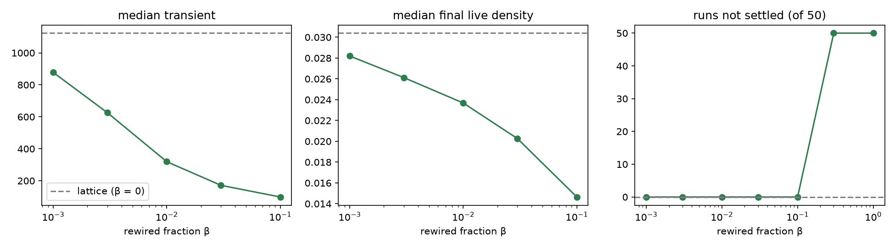
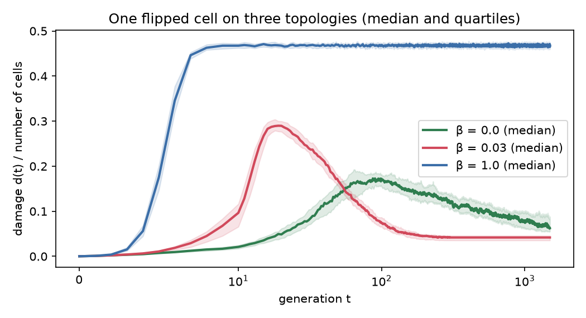
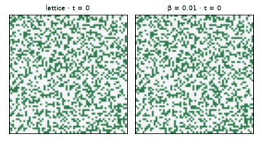

# Experiment 3: topology rewiring

> **Status:** done (v2.0-alpha.2).
> Notebook: [`notebooks/03_topology.ipynb`](../../notebooks/03_topology.ipynb) · raw data: [`data/exp03/`](../../data/exp03/)

## Question

Experiment 1 ended on a hint: the long period-$4L$ cycles exist only because the grid is a torus. So the *topology*, who is whose neighbour, shapes global behaviour. This experiment changes the topology systematically and keeps everything else fixed:

- the rule (Conway's B3/S23),
- the number of neighbours of every cell (8),
- the initial density (0.35).

Starting from a 64 × 64 torus, a fraction $\beta$ of the edges is rewired at random. $\beta = 0$ is the lattice, small $\beta$ gives a *small-world* network, $\beta = 1$ a random 8-regular network.

## Predictions (written before any run)

| # | Question | Prediction |
|---|---|---|
| 1 | Which falls first as $\beta$ grows, path length $\ell$ or clustering $C$? At what $\beta$ is $\ell$ halved? | $C$ falls first; $\ell$ is halved around $\beta \approx 0.1$ |
| 2 | Transient at $\beta = 1$ vs. the lattice (median ≈ 1000) | longer, by about 100 generations |
| 3 | Runs that do not settle within 20 000 generations? | yes; unsure at which $\beta$ |
| 4 | What is left at $\beta = 1$? | still patterns |
| 5 | Period-$4L$ gliders at $\beta = 0.01$? Most common period at $\beta = 1$? | no gliders; period about 100 |
| 6 | Damage on a small world ($\beta = 0.03$) vs. the lattice; same-attractor fraction | spreads more slowly; fraction unchanged |
| 7 | An abrupt change in the dynamics? Does it line up with the fall of $\ell$ or of $C$? | yes, with the fall of $C$ |

## Method

- **Rewiring** keeps every node's degree at 8: a fraction $\beta$ of the edges is marked, and the marked edges are shuffled by degree-preserving double-edge swaps ([ADR 0002](../adr/0002-degree-preserving-rewiring.md)). Each run uses a freshly rewired network.
- **3a Structure:** $C$ and $\ell$ (from 200 random sources) for 5 networks per $\beta$.
- **3b Dynamics:** $\beta \in \{0, 0.001, 0.003, 0.01, 0.03, 0.1, 0.3, 1\}$, 50 runs each, cap 20 000 generations.
- **3c Damage:** one flipped cell, 50 pairs each on $\beta$ = 0, 0.03, 1; 1500 generations; final attractors compared.
- **3d Comparison:** classic Watts–Strogatz rewiring (degrees not preserved) at $\beta$ = 0.01, 0.1, 1.
- **3e Transition:** $\beta \in \{0.12, 0.15, 0.18, 0.2, 0.22, 0.25\}$, 30 runs each; and a mean-field check on random networks started at densities 0.05–0.35.

Definitions are in [methods](../methods.md); background in [concepts](../concepts.md).

## Results

### 3a. Structure: a small world appears early

| $\beta$ | 0 | 0.001 | 0.003 | 0.01 | 0.03 | 0.1 | 0.3 | 1 |
|---|---|---|---|---|---|---|---|---|
| $C/C_0$ | 1 | 0.997 | 0.991 | 0.970 | 0.914 | 0.729 | 0.344 | 0.004 |
| $\ell/\ell_0$ | 1 | 0.776 | 0.601 | 0.458 | 0.355 | 0.273 | 0.223 | 0.203 |

On the lattice $C$ = 0.429 and $\ell$ = 21.3. A few shortcuts cut distances sharply ($\ell$ halves near $\beta$ = 0.01) while clustering stays almost untouched until $\beta \approx 0.1$.

### 3b. Dynamics: from freezing to boiling

| $\beta$ | 0 | 0.001 | 0.003 | 0.01 | 0.03 | 0.1 | 0.3 | 1 |
|---|---|---|---|---|---|---|---|---|
| runs not settled (of 50) | 0 | 0 | 0 | 0 | 0 | 0 | **50** | **50** |
| median transient | 1124 | 878 | 626 | 320 | 172 | 98 | — | — |
| median final live density | 0.030 | 0.028 | 0.026 | 0.024 | 0.020 | 0.015 | — | — |

Up to $\beta$ = 0.1 the soups freeze, and they freeze **faster** as $\beta$ grows. From $\beta$ = 0.3 on, no run settles. Four of these runs were continued to 100 000 generations without finding a cycle; their live density stays at 0.35–0.39 and about a third of all cells change at every step.

### 3c. Damage spreading

| $\beta$ | healed | peak median $d/N$ | at $t$ | median $d/N$ at $t$ = 1500 | same / different attractor |
|---|---|---|---|---|---|
| 0 | 0 % | 0.173 | 87 | 0.063 | 0 / 50 |
| 0.03 | 0 % | 0.290 | 19 | 0.042 | 0 / 50 |
| 1 | 0 % | 0.473 | 769 | 0.468 | never settles |

### 3d. Degree-preserving vs. classic Watts–Strogatz

| $\beta$ | method | not settled | median transient | median final density |
|---|---|---|---|---|
| 0.01 | degree-preserving | 0 | 320 | 0.024 |
| 0.01 | Watts–Strogatz | 0 | 349 | 0.024 |
| 0.1 | degree-preserving | 0 | 98 | 0.015 |
| 0.1 | Watts–Strogatz | 0 | 100 | 0.013 |
| 1 | degree-preserving | 50 | — | — |
| 1 | Watts–Strogatz | 50 | — | — |

The two rewiring schemes give almost the same results, so unequal degrees are not what drives the effects here.

### 3e. The transition

| $\beta$ | 0.1 | 0.12 | 0.15 | 0.18 | **0.2** | 0.22 | 0.25 | 0.3 |
|---|---|---|---|---|---|---|---|---|
| runs not settled | 0 % | 0 % | 0 % | 0 % | **17 %** | 100 % | 100 % | 100 % |
| median transient of settled runs | 98 | 101 | 118 | 188 | **7054** | — | — | — |
| $C/C_0$ | 0.73 | 0.68 | 0.61 | 0.55 | **0.51** | 0.48 | 0.42 | 0.34 |

The switch is sharp: it happens between $\beta$ = 0.18 and 0.22, where clustering has fallen to about half its lattice value. Just before the switch, the runs that still settle take far longer to do so.

**Mean-field check on random networks ($\beta = 1$).** The mean-field map $f(\rho)$ has fixed points at 0 (stable), **0.192** (unstable) and **0.370** (stable).

| start density | 0.05 | 0.1 | 0.15 | 0.2 | 0.35 |
|---|---|---|---|---|---|
| runs that died out (of 10) | 10 | 10 | 10 | 6 | 0 |
| late density of surviving runs | — | — | — | 0.373 | 0.373 |

### Predictions vs. results

| # | Prediction | Result |
|---|---|---|
| 1 | $C$ falls first; $\ell$ halved at $\beta \approx 0.1$ | Reversed: $\ell$ falls first and is halved near $\beta$ = 0.01, while $C$ barely moves until 0.1. This gap is exactly what a small world is. |
| 2 | slightly longer transients at $\beta = 1$ | Right direction, wrong scale: the runs never settle at all. |
| 3 | some runs never settle | Correct, and it is all or nothing: none up to $\beta$ = 0.18, all from 0.22. |
| 4 | still patterns at $\beta = 1$ | Wrong: the network keeps boiling at density 0.37 (puzzle B). |
| 5 | no gliders at $\beta = 0.01$ | Correct for 0.01 (although one glider survived at 0.001, puzzle D). The question about periods at $\beta = 1$ does not apply: there are no cycles. |
| 6 | damage spreads more slowly on a small world; same-attractor fraction unchanged | First half wrong: it spreads faster and higher (puzzle E). Second half correct: 0 of 50 on both. |
| 7 | the switch lines up with the fall of $C$ | **Correct.** The switch at $\beta \approx 0.2$ happens while $C$ is falling through half its lattice value; $\ell$ had already done most of its falling by $\beta$ = 0.01. |

## Puzzles

**A. The switch from freezing to boiling happens where clustering has halved, not where distances shrink.**
*Hint: a block is four cells that are all neighbours of each other. What does that look like in a network?*

Answer (a hypothesis)

A soup freezes by turning into still lifes and blinkers, and these depend on tightly knit groups of neighbours: a block is a 4-clique, full of triangles. Rewiring that keeps distances short but leaves the triangles alone (small $\beta$) does not stop this. Once enough triangles are broken (here $C/C_0 \approx 0.5$), small stable structures can no longer form fast enough, and the activity never dies. The alignment with $C$ is measured; the mechanism itself has not been tested directly.

**B. On the random network the live density settles at 0.37, whatever happens in detail.**
*Hint: suppose every neighbour were alive independently with probability $\rho$.*

Answer

On a random network a cell's neighbours are almost never neighbours of each other, so their states are nearly independent. Then the number of live neighbours is binomial and one step maps $\rho$ to $f(\rho) = \rho\,[P(2)+P(3)] + (1-\rho)\,P(3)$. The stable fixed point of this *mean-field* map is 0.370; the networks settle at 0.36–0.39. The damage level 0.468 matches $2\rho(1-\rho) = 0.464$: the two runs become unrelated, as in experiment 1, puzzle G. On the lattice, local structure is exactly what makes this approximation fail.

**C. Transients first get shorter as $\beta$ grows (1124 → 98), then explode just before the switch (188 at $\beta$ = 0.18, 7054 at 0.2).**
*Hint: what happens to a system that is about to tip over?*

Answer (partly open)

The explosion is **critical slowing down**: close to a transition the system hovers between its two possible fates, and the time to decide grows sharply. Why transients first get *shorter* is open. One guess: on the lattice, long transients come from gliders and debris carrying activity into regions that had already settled; shortcuts break up the geometry that lets gliders travel.

**D. With only 0.1 % of edges rewired, one run still ended with period 256 = $4L$.**
*Hint: a glider only ever visits one diagonal band of the torus.*

Answer

At $\beta$ = 0.001 about 16 of 16 384 edges are rewired, touching less than 1 % of the cells. A glider circling the torus visits a narrow diagonal band; the chance that the band misses every rewired cell is of the order of 20 %, so an occasional surviving glider is expected.

**E. Damage spreads faster and higher on a small world than on the lattice.**
*Hint: on the lattice a difference can move at most one cell per generation.*

Answer

Shortcuts carry the difference straight to distant parts of the grid, where it starts spreading again, so the damage grows from many places at once. It peaks at generation 19 instead of 87.

**F. On the random network, soups started at density 0.15 or less always die out, at 0.2 about half die, and at 0.35 none die.**
*Hint: the mean-field map has a second non-zero fixed point.*

Answer

$f(\rho) = \rho$ has three solutions: 0 (stable), 0.192 (unstable) and 0.370 (stable). Below 0.192 the density drifts down to 0, above it up to 0.37: the system is **bistable**, and 0.192 is the dividing line. Starting at 0.2, right next to the line, 6 of 10 runs died, as expected from random fluctuations around an unstable point.

## Conclusions

- **Topology alone can switch the global behaviour.** With the same rule, the same number of neighbours and the same starting density, Life freezes within about 100–1000 generations on lattices and small worlds, and boils forever once about 20 % of the edges are rewired.
- **The switch follows clustering, not distance.** Short paths arrive early ($\beta \approx 0.01$) and change little; the switch comes when clustering has halved ($\beta \approx 0.2$).
- **Random networks are mean-field systems.** Their behaviour, including the boiling density 0.37 and the extinction threshold 0.19, follows from a one-line formula that ignores space entirely.
- **Near the switch the system slows down**, a generic warning sign of an approaching transition.

## Limitations

- One grid size (64 × 64): whether the switch sharpens into a true phase transition on larger networks, or moves, is not known.
- 30–50 runs per $\beta$; the transition point is located to within about ±0.02.
- "Never settles" means no cycle within 20 000 generations (checked to 100 000 for four runs); a cycle longer than that cannot be ruled out.
- The clustering mechanism (puzzle A) is a hypothesis consistent with the data, not a tested explanation.

## Open questions

- Does $\beta_c$ depend on the network size, and does the switch get sharper as the network grows?
- Can the mechanism behind puzzle A be tested directly, e.g. by rewiring while keeping clustering fixed?
- Why do transients get shorter for small $\beta$ (puzzle C)?
