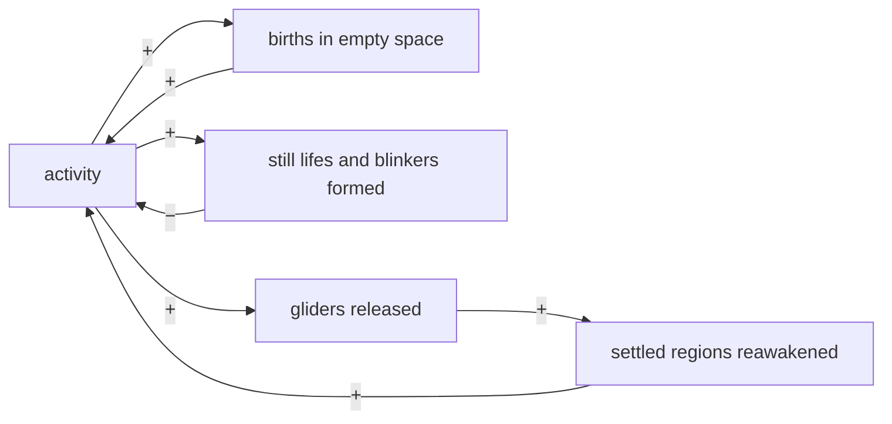
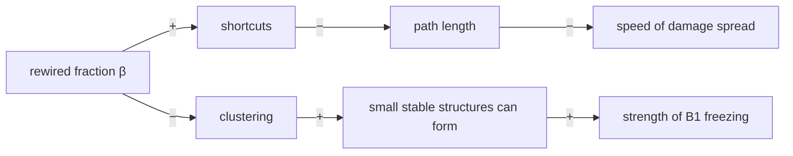
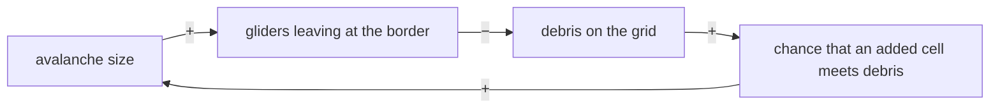
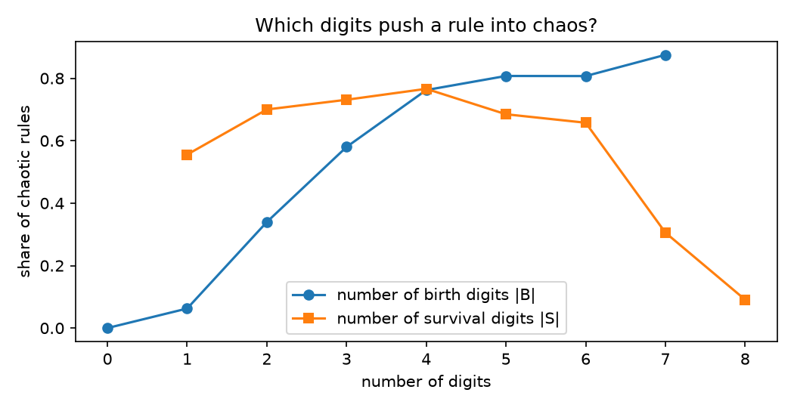

# Experiment 4: a systems view

> **Status:** done (v2.0-alpha.4).
> Notebook: [`notebooks/04_systems.ipynb`](../../notebooks/04_systems.ipynb) · raw data: [`data/exp04/`](../../data/exp04/)

## Questions

1. **Causal loops (4a).** Can the mechanisms found in experiments 1–3 be written as feedback loops, and which loop dominates when?
2. **Rule space (4b).** Conway's B3/S23 is one of $2^{17}$ life-like rules without B0. How common is behaviour like Life's, and what pushes a rule into chaos?
3. **Life's neighbourhood (4c).** Is Life robust: what happens to the 17 rules that differ from it by one digit?

## Predictions (written before any run)

| # | Question | Prediction |
|---|---|---|
| 1 | Most common class among random rules | dead or frozen |
| 2 | Share of complex rules | 5–10 % |
| 3 | Do chaotic rules have high or low $\lambda$? Do complex rules cluster at an "edge of chaos"? | high; yes |
| 4 | How many of Life's 17 one-digit neighbours are still complex? | about 3 |
| 5 | Which leads to chaos more: extra birth digits or extra survival digits? | extra survival digits |
| 6 | On the lattice, does a balancing loop (freezing) or a reinforcing loop (spreading) dominate Life in the long run? | balancing (freezing) |

## 4a. Causal loop diagrams

An arrow marked **+** means the two quantities move in the same direction, **−** in opposite directions. A loop with an even number of − signs is **reinforcing (R)**, with an odd number **balancing (B)**. Every arrow below is backed by a result from experiments 1–3.

### Loop diagram 1: Life on a lattice (experiment 1)

| Loop | Mechanism | Evidence |
|---|---|---|
| **R1 ignition** | activity causes births, births are activity | one flipped cell grows to 17 % of the grid in about 80 generations (1c) |
| **B1 freezing** | activity leaves still lifes and blinkers behind, which end activity | all 650 soups freeze, at about 3 % live cells (1a) |
| **R2 reawakening** | gliders carry activity into regions that had settled | long periods $= 4L$ come from circling gliders (puzzle 1A); the slowest region sets the transient (puzzle 1C) |

**B1 wins in the long run**; R1 and R2 only decide how long it takes (about 1000 generations on 64 × 64).

### Loop diagram 2: rewiring (experiment 3)

Below $\beta \approx 0.2$, B1 still dominates and soups freeze, faster than on the lattice. Above it, clustering has fallen to about half, B1 is too weak, and **R1 takes over**: the network boils forever. In systems language the transition is a **shift in loop dominance**.

### Loop diagram 3: driven avalanches with open borders (experiment 2)

| Loop | Mechanism | Evidence |
|---|---|---|
| **B3 draining** | large avalanches export gliders, debris shrinks, added cells meet less debris, avalanches shrink | the 32 × 32 grid drains to the empty absorbing state after 631 avalanches (puzzle 2D) |

In a sandpile every added grain stays on the pile until an avalanche carries it to the edge, so the drive steadily builds up the stock that avalanches release. In Life most added cells simply die (puzzle 2C) and avalanches export material, so the stock is not rebuilt; this is one systems-level reason why Life does not settle into a critical state.

## 4b. Rule space

500 distinct rules drawn uniformly (B0 excluded); each runs 10 soups at density 0.35 on a 32 × 32 torus for up to 2000 generations. Classes follow [ADR 0004](../adr/0004-rule-classification.md).

| class | dead | frozen | periodic | complex | chaotic |
|---|---|---|---|---|---|
| rules (of 500) | 9 | 83 | 58 | 16 | **334** |
| share | 1.8 % | 16.6 % | 11.6 % | 3.2 % | **66.8 %** |

Life itself is classified as complex under the same settings.

**Along $\lambda$:** the share of chaotic rules rises from about 20 % at $\lambda \approx 0.2$ to about 80 % at $\lambda \approx 0.56$ and falls again for the few rules with very high $\lambda$. Complex rules make up 0–6 % at every $\lambda$; their mean $\lambda$ (0.46) is almost the same as that of chaotic (0.48) and frozen (0.45) rules. The 16 complex rules in the sample have $\lambda$ between 0.33 and 0.61, while Life has 0.17.

**Birth vs. survival digits:** the number of birth digits correlates positively with being chaotic (+0.37), the number of survival digits negatively (−0.21). The effect comes almost entirely from the lowest birth digits:

| rules containing | B1 | B2 (no B1) | neither B1 nor B2 |
|---|---|---|---|
| number of rules | 256 | 115 | 129 |
| share chaotic | 79 % | 83 % | 27 % |

**Threshold sensitivity:** changing the "chaotic damage" threshold from 0.25 to 0.75 changes nothing (damage is either near 0 or near full decorrelation). Changing the "long transient" threshold from 50 to 150 generations moves the complex share between 6.6 % and 2.4 %.

## 4c. Life's neighbourhood

| change | +B1 | +B2 | −B3 | +B4 | +B5 | +B6 | +B7 | +B8 |
|---|---|---|---|---|---|---|---|---|
| class | chaotic | chaotic | frozen | chaotic | complex | complex | complex | complex |

| change | +S0 | +S1 | −S2 | −S3 | +S4 | +S5 | +S6 | +S7 | +S8 |
|---|---|---|---|---|---|---|---|---|---|
| class | chaotic | chaotic | dead | periodic | periodic | chaotic | chaotic | complex | complex |

Of 17 neighbours, 6 are complex, 7 chaotic, 2 periodic, 1 frozen and 1 dead. On a 64 × 64 grid (threshold scaled with Life's own transient, 431 → 967) the complex neighbours stay complex, except B3/S237, which then settles in only 20 % of soups and is classified chaotic.

**How often each entry of the rule table is used** in Life soups (64 × 64, 1000 generations): dead cells have 1 or 2 live neighbours in 7.3 % and 7.1 % of cell-steps, but 5, 6, 7, 8 in 0.73 %, 0.16 %, 0.03 %, 0.003 %; live cells have 5, 6, 7, 8 live neighbours in 5.6 %, 1.7 %, 0.3 %, 0.04 %.

### Predictions vs. results

| # | Prediction | Result |
|---|---|---|
| 1 | dead or frozen most common | **Wrong:** two thirds of random rules are chaotic (puzzle A). |
| 2 | 5–10 % complex | Slightly high: 3.2 %, or 2.4–6.6 % depending on the threshold. |
| 3 | chaotic rules have high $\lambda$; complex rules cluster at an edge of chaos | First half roughly right (chaos peaks at intermediate-to-high $\lambda$, then falls); second half **not supported**: complex rules do not cluster in $\lambda$ (puzzle D). |
| 4 | about 3 of 17 neighbours still complex | 6 of 17 (5 on the larger grid). |
| 5 | extra survival digits push towards chaos | **Reversed:** extra birth digits, above all B1 and B2, push towards chaos; extra survival digits make chaos less likely (puzzles A and B). |
| 6 | balancing (freezing) loop dominates | **Correct:** B1 wins on every lattice run; reinforcing loops set the transient. |

## Puzzles

**A. Two thirds of all random rules are chaotic.**
*Hint: what happens if a dead cell with a single live neighbour is born?*

Answer

With B1 or B2, births happen almost everywhere a live cell is nearby, so any live cell seeds new ones and activity spreads like fire. Half of all rules contain B1 and another quarter contain B2 without B1; 79–83 % of these are chaotic, against 27 % of rules with neither. Life-like rules that are not chaotic almost all start birth at 3 or more neighbours.

**B. Extra survival digits make chaos less likely, extra birth digits more likely.**
*Hint: what does a survival digit do to a live cell, and what does a birth digit do to an empty one?*

Answer

Survival digits only keep existing cells alive; they make patterns more persistent, which favours crowded or frozen end states. Birth digits create new cells in empty space, which is what spreads activity (loop R1). Correlations with being chaotic: +0.37 for the number of birth digits, −0.21 for survival digits.

**C. Adding B5, B6, B7, B8 or S7, S8 to Life changes almost nothing, but adding B1, B2, S0, S1, S5 or S6 tips it into chaos.**
*Hint: how often does a cell in a Life soup actually have 7 live neighbours?*

Answer

A rule entry only matters if it is used. In Life soups dead cells almost never have 5 or more live neighbours (under 1 % of cell-steps, 0.003 % for 8), so adding B5–B8 hardly ever fires; live cells with 7 or 8 neighbours are similarly rare. Entries that are used often (B1 and B2 about 7 % each, S1 13 %, S5 6 %) change the dynamics completely. B4 (about 1 %) is the exception: each extra birth there feeds more crowded neighbourhoods and the change snowballs.

**D. Langton's $\lambda$ does not find the complex rules.**
*Hint: $\lambda$ counts how many entries produce life. Does it know which entries are used?*

Answer (partly open)

$\lambda$ treats B1 and B8 the same, but puzzle C shows that their effects are completely different because B1 is used thousands of times more often. Complex rules in the sample range from $\lambda$ = 0.33 to 0.61, and Life sits at 0.17, outside that range. For life-like rules, a measure weighted by how often each neighbour count occurs would probably be a better coordinate than $\lambda$; that has not been tested here.

**E. The Replicator rule B1357/S1357 empties a 32 × 32 torus at generation 16, from any starting state, but not a 48 × 48 one.**
*Hint: under this rule a cell's next state is the parity of its live neighbours. What is a parity rule applied 16 times?*

Answer

For B1357/S1357 the next state of every cell is the parity (odd or even) of its number of live neighbours, whatever the cell's own state, so the update is linear over the integers mod 2: the sum of the eight shifted copies of the grid. Applying it $2^k$ times gives the sum of the eight shifts by $2^k$ cells (all cross terms come in pairs and cancel mod 2). On a 32-cell torus a shift by +16 is the same as a shift by −16, so after 16 steps every shift appears an even number of times and the sum is zero: every grid is empty. On 48 × 48 no such cancellation occurs. Five random soups on 32 × 32 all died at exactly generation 16.

## Conclusions

- **Feedback loops summarise the first three experiments**: a freezing loop that wins on lattices, reinforcing loops that set how long it takes, a transition when clustering weakens the freezing loop, and a draining loop that keeps driven avalanches from becoming critical.
- **Chaos is the norm in rule space**, driven by low birth digits. Complex behaviour like Life's is rare, about 3 % of rules.
- **Life is moderately robust**: one-digit changes to entries it rarely uses keep it complex; changes to entries it uses often break it. Robustness depends on how a rule is used, not just on how it is written.
- **$\lambda$ is too coarse** to locate complexity among life-like rules.

## Limitations

- Classification on a 32 × 32 torus with a 2000-generation cap; transient thresholds depend on grid size, and borderline rules (such as B3/S237) can change class on a larger grid.
- 500 of 131 072 rules; the complex class has only 16 members, so its properties are known roughly.
- Ten soups per rule at a single density (0.35); some rules behave differently at other densities.
- The causal loop diagrams are qualitative summaries; the strength of each loop has not been measured directly.

## Open questions

- Would a usage-weighted version of $\lambda$ separate complex from chaotic rules?
- Do the complex rules found here have gliders or other moving patterns, like Life?
- Can the strength of the freezing loop be measured directly (e.g. the rate at which still lifes form) and tied to the transition in experiment 3?
