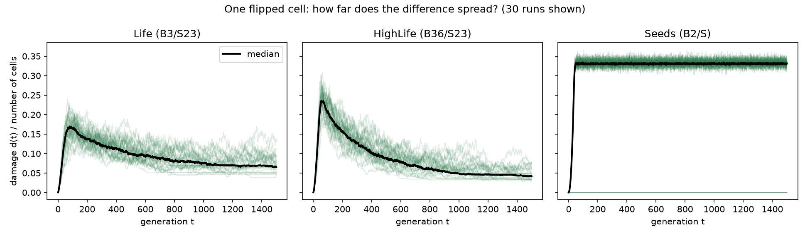
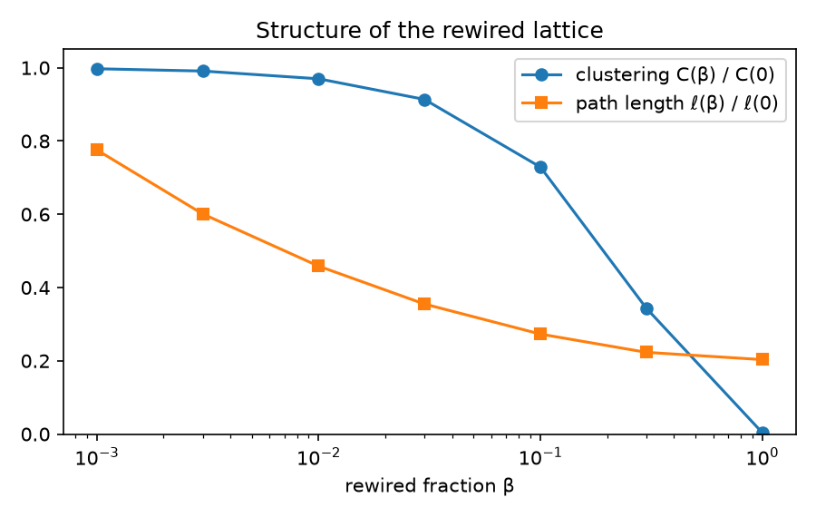
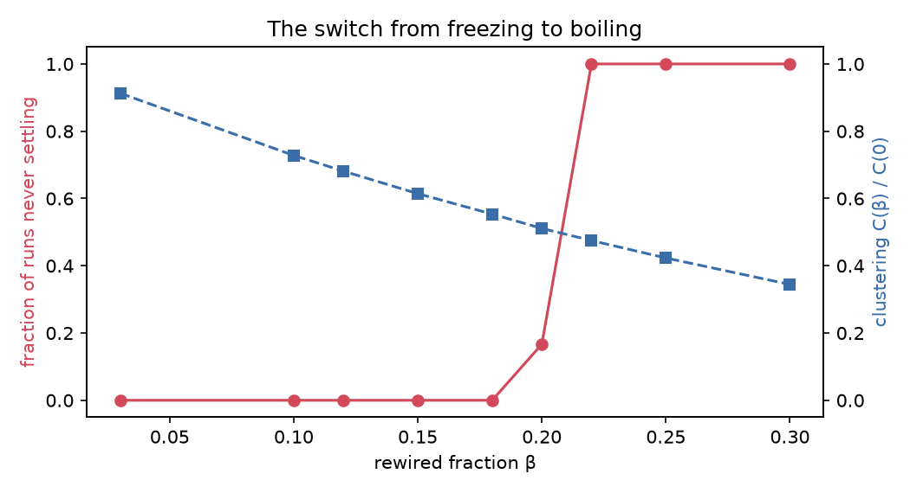
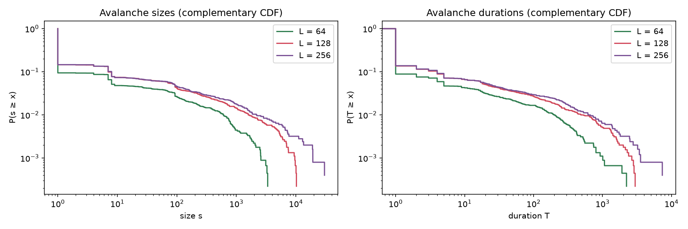
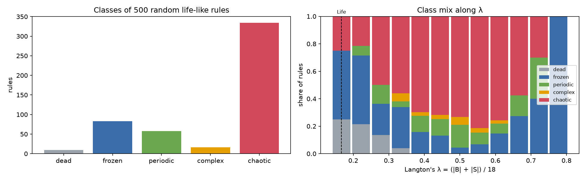
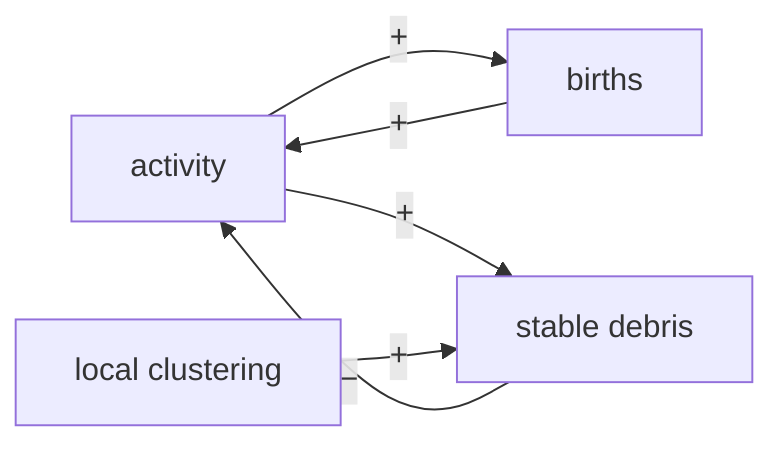

# How local rules and topology shape global behaviour: four experiments with the Game of Life

*Report on v2 of this project. [中文版](report.zh.md) · [Policy brief](policy-brief.md)*

## Summary

Conway's Game of Life has one local rule: a dead cell with exactly three live neighbours is born, a live cell with two or three survives. Four experiments asked how far that rule alone decides what happens, and how much depends on *who counts as a neighbour*. The answers: on a grid, random soups always freeze after about a thousand generations, but the final pattern depends on every single cell; rewiring about a fifth of the neighbour links switches the same rule from freezing to boiling forever; the claim that Life is "self-organized critical" does not survive a check across grid sizes; and among all similar rules, Life's kind of complexity is rare (about 3 %). Throughout, each experiment started with written predictions; 8 of 27 were right, 11 half right and 8 wrong.

## The question and the engine

*How do local rules and the interaction topology together determine global behaviour?*

Every update is computed as `next = f(state, A · state)`: `A · state` counts each cell's live neighbours, and `f` is the rule. On a square lattice the count is a convolution; on any other network it is a sparse matrix product. A lattice is just one particular `A`, and the tests check that both computations agree cell by cell ([ADR 0001](adr/0001-unified-engine.md)). This makes it possible to change the topology while keeping everything else fixed.

## Experiment 1: attractors and chaos

*How long do random soups take to settle, on what, and how much does one cell matter?* ([details](experiments/01-attractors.md))

All 650 soups on tori of side 16 to 128 settled into a cycle. The typical transient was about 1000 generations on 64 × 64 (predicted: 10 000), and it grew more slowly than the grid area, because the whole grid waits only for its slowest region. Three quarters of the final cycles had period 2: one blinker anywhere is enough, since the grid's period is the least common multiple of its objects' periods. The rare long periods were exactly $4L$, a single glider circling the torus.


Flipping one initial cell changed the final state in every pair tried (100 under Life, 100 under the close variant HighLife). The difference first spread, then shrank as the soup thinned out, but the two runs never came back together.



## Experiment 3: topology rewiring

*Same rule, same number of neighbours: what changes if some neighbours are swapped for random distant cells?* ([details](experiments/03-topology.md))

A fraction $\beta$ of the lattice links was rewired while every cell kept exactly 8 neighbours ([ADR 0002](adr/0002-degree-preserving-rewiring.md)). Distances collapse early: the mean path length halves at $\beta \approx 0.01$, while clustering, the chance that two neighbours are also neighbours of each other, barely moves until $\beta \approx 0.1$. This is the classic small world.



The dynamics did not follow the distances. Up to $\beta$ = 0.18 every soup froze, faster than on the lattice. From $\beta$ = 0.22 none did: the network boils forever at a live density of 0.37, exactly the value a mean-field formula predicts when neighbours are independent. The switch happens where clustering has fallen to half its lattice value, and just before it the soups that still freeze take dramatically longer (median 188 → 7054 generations), a classic sign of an approaching transition.



## Experiment 2: phase transition and criticality

*Does the starting density matter, and are Life's avalanches critical?* ([details](experiments/02-criticality.md))

Between starting densities 0.1 and 0.7 the outcome hardly changes: about 3 % of cells remain. Extinction at low density turned out to be a finite-size effect: a grid survives if a single stable object forms anywhere, so larger grids survive from lower densities.

Avalanches were triggered by adding one live cell to a settled grid with open edges ([ADR 0003](adr/0003-avalanche-definition.md)). On a 128 × 128 grid their sizes looked like a power law with exponent about 1.6, the evidence Bak, Chen and Creutz used in 1989 to call Life self-organized critical. Two checks changed the picture. The smallest grid drained: gliders carried material out, and after 631 avalanches the grid was empty for good. And going from 128 to 256, the 99th percentile of avalanche size barely moved (1578 → 1857) while the area grew fourfold, so large avalanches seem to have a typical scale. Life's avalanches have a heavy tail, but are probably not critical.



## Experiment 4: a systems view

*Where does Life sit among all similar rules?* ([details](experiments/04-systems.md))

Of 500 random life-like rules, two thirds were chaotic, mostly because a birth digit of 1 or 2 lets activity spread like fire; only about 3 % were complex like Life. Langton's $\lambda$, the share of rule entries that produce life, did not locate them. Of Life's 17 one-digit neighbours, 6 stayed complex, and the pattern is telling: changes to entries Life almost never uses (8 live neighbours occur in 0.003 % of cell updates) change nothing, while changes to entries it uses often break it.



## Three lessons across the experiments

**1. Topology can matter as much as the rule.** The same rule, with the same number of neighbours per cell, freezes on a lattice and boils on a random network. Global behaviour is a property of rule *and* wiring together.

**2. Local clustering is the brake.** Life freezes because activity leaves behind still lifes and blinkers, which need tightly knit groups of neighbours. A reinforcing loop (activity → births → activity) competes with this balancing loop (activity → stable debris → less activity). On lattices and small worlds the brake wins; when rewiring breaks enough local triangles, the reinforcing loop takes over.



**3. One plot is not a conclusion.** The power law at one grid size, the threshold at one network size, the classification at one threshold: each looked convincing alone and changed or held up only when checked across sizes and settings. The two most useful habits were checking several system sizes and asking why an odd number appeared (the period $4L$, the 1/3 damage level, the empty 32 × 32 grid) before writing it up.

## Prediction scorecard

Predictions were written before each run.

| Experiment | Right | Half right | Wrong |
|---|---|---|---|
| 1 Attractors | 2 | 3 | 1 |
| 3 Topology | 3 | 2 | 2 |
| 2 Criticality | 2 | 3 | 3 |
| 4 Rule space | 1 | 3 | 2 |
| **Total (27)** | **8** | **11** | **8** |

The misses had a pattern. Magnitudes were off (transients ten times too long; an avalanche slope of −1 instead of −1.6), and intuitions of the form "more is more" failed (extra survival digits *reduce* chaos; distances fall long before clustering). The hits were structural: the switch tracks clustering, the freezing loop dominates, the final density does not depend on the starting one.

## Limitations

- Grids of at most 256 × 256 and a few thousand runs per question; several exponents and thresholds are known only roughly.
- Classes and avalanches depend on choices (thresholds, step caps, open borders) that are documented in the ADRs and checked for sensitivity, but not exhaustively.
- The mechanisms in lesson 2 are supported by where the transition happens, not tested directly.

## Open questions

- Does the freezing-to-boiling switch sharpen into a true phase transition on larger networks, and does $\beta_c$ move?
- Does the 99th percentile of avalanche size keep levelling off at 512 × 512?
- Would a usage-weighted version of $\lambda$ find the complex rules?
- Why do small amounts of rewiring make soups freeze *faster*?

All [puzzles](puzzles.md) the data turned up are collected in one place.

## Reproducing the results

```
python -m venv .venv
.venv/bin/python -m pip install -e ".[dev,nb]"      # Windows: .venv\Scripts\python.exe
.venv/bin/python -m pytest -q
.venv/bin/python -m jupyter lab notebooks/
```

Each notebook regenerates its figures in `docs/figures/` and its raw data in `data/`; seeds are fixed, so results repeat exactly.
