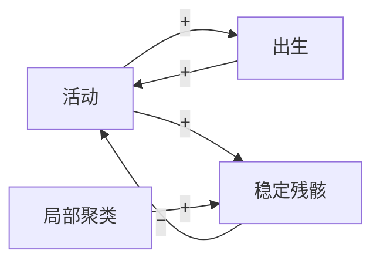

# 局部规则和拓扑怎样塑造全局行为：用 Game of Life 做的四个实验

*本项目 v2 的实验报告。[English](report.md) · [政策简报](policy-brief.zh.md)*

## 摘要

Conway 的 Game of Life 只有一条局部规则：死细胞恰好有 3 个活邻居就出生，活细胞有 2 或 3 个活邻居就存活。四个实验想弄清楚两件事：这条规则本身能决定多少，又有多少取决于"谁算谁的邻居"。

结论是：在方格上，随机初始状态（soup）大约一千代后一定会冻结，但最后长成什么样，取决于每一个初始细胞；只把约五分之一的邻居关系随机重连，同一条规则就从"冻结"变成"永远沸腾"；"Life 是自组织临界（self-organized critical）的"这一说法，经不起跨网格尺寸的检验；在所有同类规则里，像 Life 这样的复杂行为很少见，约占 3%。

每个实验运行前都先写下预测。27 条预测里，对 8 条，半对 11 条，错 8 条。

## 问题和引擎

*局部规则和交互拓扑怎样共同决定全局行为？*

每一步更新都写成 `next = f(state, A · state)`：`A · state` 是每个细胞的活邻居数，`f` 是规则。方格上用卷积来算邻居数，任意网络上用稀疏矩阵乘法来算。方格只是 `A` 的一个特例，测试会逐格核对两种算法的结果完全一致（[ADR 0001](adr/0001-unified-engine.md)）。这样就能做到只改拓扑，其他一切不变。

## 实验 1：吸引子与混沌

*随机初始状态要多久才稳定？稳定在什么上？一个细胞有多大影响？*（[详细](experiments/01-attractors.md)）

边长 16 到 128 的环面上，650 个随机初始状态全部进入了循环。64 × 64 上的典型暂态长度约 1000 代（预测是 10 000），而且暂态增长得比网格面积慢，因为整张网格只等最慢的那块区域。

四分之三的最终循环周期是 2：整张网格的周期是所有物体周期的最小公倍数，只要哪里有一个 blinker，整体周期就是 2。少数很长的周期恰好等于 4L，那是一个 glider 在环面上绕圈。


只翻转一个初始细胞，在试过的每一对里（Life 100 对，近亲规则 HighLife 100 对），最终状态全都变了。差异先扩散开，又随着网格变稀疏而缩小，但两条轨迹再也没有重合。


## 实验 3：拓扑重连

*规则不变、邻居数不变，只把一部分邻居换成随机的远处格子，会怎样？*（[详细](experiments/03-topology.md)）

把比例为 β 的连接随机重连，同时保证每个格子始终有 8 个邻居（[ADR 0002](adr/0002-degree-preserving-rewiring.md)）。

距离很早就缩短了：β ≈ 0.01 时平均路径长度已经减半。聚类系数（两个邻居彼此也是邻居的概率）则要到 β ≈ 0.1 才开始明显下降。这就是经典的小世界（small world）。


但动力学并不跟着距离走。β 到 0.18 为止，每个初始状态都会冻结，而且比在方格上冻结得更快。从 β = 0.22 开始，没有一个冻结：网络以 0.37 的活细胞密度永远沸腾下去，这个数值正好等于"邻居相互独立"假设下平均场公式算出的值。

突变发生在聚类系数降到方格的一半左右的位置。就在突变之前，那些还能冻结的初始状态，冻结所需的时间急剧变长（中位数从 188 代涨到 7054 代）。这是系统接近突变的典型信号。


## 实验 2：相变与临界性

*初始密度重要吗？Life 的雪崩是临界的吗？*（[详细](experiments/02-criticality.md)）

初始密度在 0.1 到 0.7 之间时，结局几乎一样：最后约 3% 的细胞活着。低密度下的灭绝其实是有限尺寸效应：只要网格上**任何一处**形成一个稳定物体，整张网格就不会死光，所以网格越大，越低的密度也能存活。

雪崩的做法是：往一张已经稳定、边界开放的网格里加一个活细胞（[ADR 0003](adr/0003-avalanche-definition.md)）。在 128 × 128 上，雪崩大小看起来服从指数约 1.6 的幂律，这正是 Bak、Chen 和 Creutz 在 1989 年称 Life 为"自组织临界"的依据。

两项检查改变了这个判断：

- 最小的网格被抽干了：glider 把物质带出边界，第 631 次雪崩后网格变空，再也回不来。
- 网格从 128 增大到 256，面积变为 4 倍，雪崩大小的 99 分位数却几乎没动（1578 → 1857）。这说明大雪崩有一个典型尺度。

所以 Life 的雪崩有重尾，但大概不是临界的。


## 实验 4：系统视角

*在所有同类规则里，Life 处在什么位置？*（[详细](experiments/04-systems.md)）

500 条随机规则里，三分之二是混沌的。主要原因是出生数字含 1 或 2，活动像野火一样蔓延。像 Life 这样复杂的只有约 3%。Langton 的 λ（规则表里产生活细胞的条目所占比例）找不到这些复杂规则。

Life 的 17 条"只差一位数字"的邻居规则里，有 6 条仍然是复杂的，规律很说明问题：改动 Life 几乎用不到的条目（8 个活邻居只占所有细胞更新的 0.003%），什么都不会变；改动它常用的条目，复杂性就会被破坏。


## 贯穿四个实验的三点结论

**1. 拓扑可以和规则一样重要。** 同一条规则、每格同样 8 个邻居，在方格上会冻结，在随机网络上会沸腾。全局行为由规则和连接方式共同决定。

**2. 局部抱团是"刹车"。** Life 之所以会冻结，是因为活动会留下 still life 和 blinker，而这些稳定结构需要彼此紧密相连的邻居。增强回路（活动 → 出生 → 活动）和调节回路（活动 → 稳定残骸 → 活动减少）在相互竞争。在方格和小世界上，刹车占上风；重连拆掉足够多的局部三角形之后，增强回路就接管了。



**3. 一张图下不了结论。** 单一网格尺寸下的幂律、单一网络规模下的阈值、单一阈值下的分类，单独看都很有说服力。它们是被推翻还是站得住，都要换几个尺寸和设置检查过才知道。

最有用的两个习惯是：检查多个系统尺寸；看到奇怪的数字时，先问为什么（周期恰好是 4L、损伤恰好是 1/3、32 × 32 的网格变空了），再写结论。

## 预测记分卡

每次运行之前都写下了预测。

| 实验 | 对 | 半对 | 错 |
|---|---|---|---|
| 1 吸引子 | 2 | 3 | 1 |
| 3 拓扑 | 3 | 2 | 2 |
| 2 临界性 | 2 | 3 | 3 |
| 4 规则空间 | 1 | 3 | 2 |
| **合计（27）** | **8** | **11** | **8** |

错误有规律可循。一是数量级猜错：暂态长度高估了十倍，雪崩斜率猜的是 −1，实际是 −1.6。二是"越多越如何"的直觉失灵：多加存活数字反而**减少**混沌；距离比聚类早得多就下降了。

猜对的多是结构性判断：突变跟着聚类走、冻结回路占主导、最终密度与初始密度无关。

## 局限

- 网格最大 256 × 256，每个问题只跑了几千次，好几个指数和阈值只知道大概。
- 分类和雪崩的结果依赖于一些人为选择（阈值、步数上限、开放边界）。这些选择都写进了 ADR，也做了敏感性检查，但没有穷尽所有可能。
- 结论 2 里的机制，目前的证据只是突变发生的位置，机制本身还没有直接检验。

## 开放问题

- 在更大的网络上，"冻结 → 沸腾"会不会锐化成真正的相变？突变点 β_c 会不会移动？
- 到 512 × 512，雪崩大小的 99 分位数是否仍然停滞？
- 按使用频率加权的 λ，能否找到复杂规则？
- 为什么少量重连会让初始状态冻结得**更快**？

数据里冒出来的所有[谜题](puzzles.md)都汇总在一处。

## 复现

```
python -m venv .venv
.venv/bin/python -m pip install -e ".[dev,nb]"      # Windows: .venv\Scripts\python.exe
.venv/bin/python -m pytest -q
.venv/bin/python -m jupyter lab notebooks/
```

每本 notebook 都会重新生成 `docs/figures/` 里的图和 `data/` 里的原始数据。随机种子是固定的，结果可以逐字复现。
